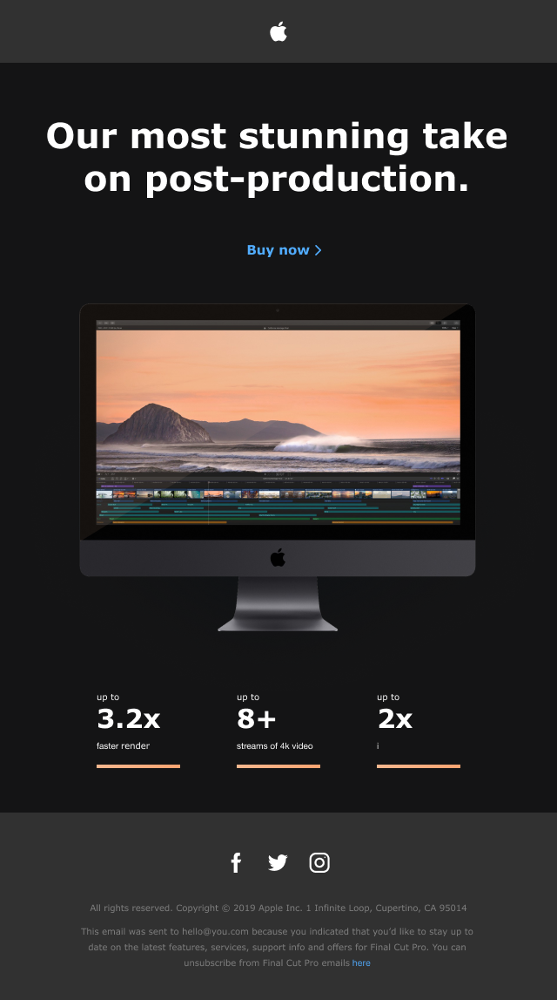

# Apple Production

Учебная адаптивная верстка промостраницы Apple, посвященной возможностям Final Cut Pro и производительности Mac.

## О проекте

Страница состоит из трех основных частей:

- шапки с логотипом Apple;
- главного экрана с призывом к покупке, изображением Mac и карточками характеристик;
- подвала с социальными сетями и информационным текстом.

Проект выполнен без JavaScript и сторонних библиотек.

## Технологии

- HTML5;
- CSS3;
- Flexbox;
- адаптивная верстка;
- методология именования BEM;
- локальное подключение шрифтов через `@font-face`;
- SVG-иконки.

## Особенности

- контент ограничен шириной `640px`;
- карточки автоматически переносятся на узких экранах;
- для экранов шириной до `460px` добавлены боковые отступы;
- начертания Verdana и Helvetica Neue подключены локально;
- стрелка возле ссылки **Buy now** добавлена псевдоэлементом `::after`.

